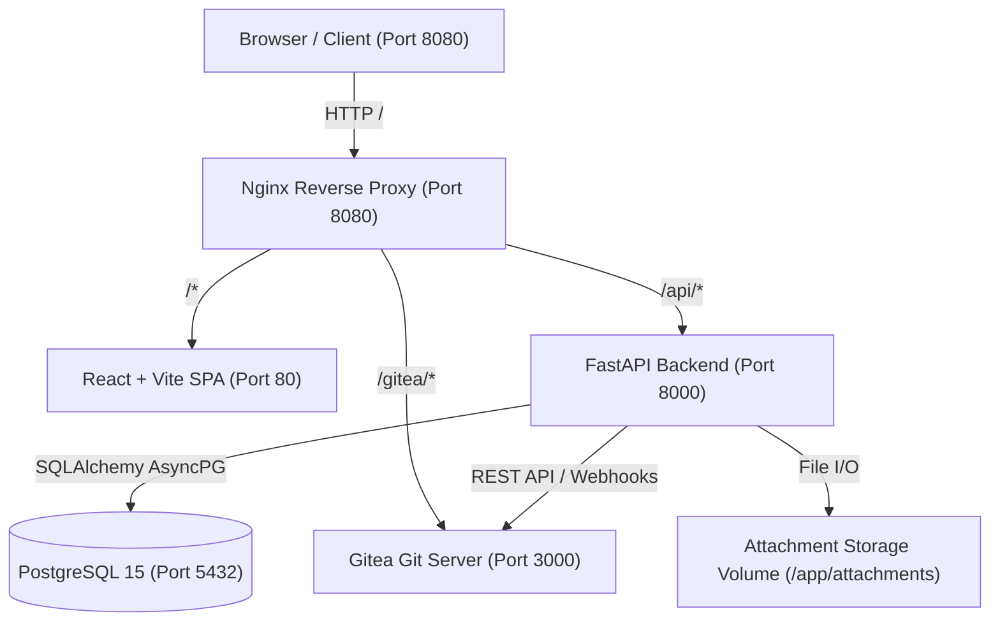

# ⚡ Engineering PMS (Project Management System)

[](https://fastapi.tiangolo.com)
[](https://react.dev)
[](https://www.typescriptlang.org)
[](https://www.postgresql.org)
[](https://about.gitea.com)
[](https://www.docker.com)
[](https://tailwindcss.com)

> **A mission-critical Project Management & Version Control System engineered specifically for Hardware, Embedded Firmware, and Software Engineering Teams.**

---

## 📑 Table of Contents

- [Overview](#-overview)
- [Key Features](#-key-features)
- [System Architecture](#-system-architecture)
- [Tech Stack](#-tech-stack)
- [Repository Structure](#-repository-structure)
- [Quick Start Guide](#-quick-start-guide)
  - [Prerequisites](#prerequisites)
  - [1. Running via Docker Compose (Recommended)](#1-running-via-docker-compose-recommended)
  - [2. Running Locally for Development](#2-running-locally-for-development)
- [Environment Configuration](#-environment-configuration)
- [Credentials & Seed Accounts](#-credentials--seed-accounts)
- [API Reference Overview](#-api-reference-overview)
- [Automated Email & Push Reminders](#-automated-email--push-reminders)
- [Inbuilt Gitea VCS Hub](#-inbuilt-gitea-vcs-hub)
- [Appearance & Themes](#-appearance--themes)
- [Production Deployment](#-production-deployment)
- [Testing & Quality Assurance](#-testing--quality-assurance)
- [Developer Handover](#-developer-handover)

---

## 🌟 Overview

Standard project management tools (Jira, Trello, Asana) treat software and hardware engineering as generic tickets. **Engineering PMS** bridges the gap between hardware bench testing, embedded firmware commits, and project tracking:

- **Dual-View Dashboards**: Engineers get an action-oriented Daily Focus & Bench Tracker; Leadership gets real-time operational telemetry, resource allocation, and broadcast triggers.
- **Role-Based Project Isolation**: Only Admins/Managers can create and allocate projects; individual Engineers only see their assigned projects and focus on execution.
- **Inbuilt Gitea Git Hub**: Full embedded Git VCS with subpath proxying, terminal push command generators, and one-click commit SHA linkers directly inside task views.
- **Escalation & Cadence Triggers**: Morning kickoff reminders (8:30 AM) and evening push/timesheet wrap-up reminders (4:00–5:30 PM) that escalate stale tasks to Project Managers in CC.
- **Hardware Circuit Design Aesthetics**: Engineered with high-contrast Obsidian Dark and Warm Ivory Light modes, paired with hardware-inspired accent palettes (Amber Copper, Emerald PCB, Firmware Blue).

---

## 🚀 Key Features

### 1. Dual-View Operational Dashboard
- **Engineer Day Plan View**:
  - Daily kickoff checklist and day planning notes.
  - Priority Project spotlight card with quick links.
  - Live Work Hours logger (tracked today vs 8-hour target).
  - Priority task queue and pending deliverables breakdown.
  - Next assigned tasks queue for continuous pipeline visibility.
- **Admin & Manager Operations View**:
  - High-level KPIs: Active projects, total team velocity, overdue deliverables.
  - Real-time team capacity & workload heatmaps.
  - One-click morning/evening broadcast triggers with audit logs.
  - Centralized team activity stream.

### 2. Projects & 3D Hardware Cards
- **Role-Based Access Control (RBAC)**:
  - Admins retain exclusive rights to create (`POST /api/projects`) and configure projects.
  - Engineers only view projects where they are assigned members.
  - Non-admins cannot see unassigned projects or project creation buttons.
- **3D Elevation Project Cards**:
  - Circuit vector graphics with status-tinted gradients.
  - Real-time progress bars, priority badges, and active team avatar stacks.
  - Seamless view switcher between **3D Grid Cards** and **Data Table** layout.

### 3. Integrated Gitea VCS & Git Push Helper
- Embedded Gitea repository browser under `/gitea/` with asset rewrite rules.
- **Terminal Push Command Generator**: Generates formatted push commands copying branch, commit message, and task number (`#<id>`) in one click.
- **Direct Commit Linker**: Allows engineers to attach commit SHA, branch, and notes directly to a task without leaving the web interface.
- Automatic HMAC-SHA256 verified webhook syncing on commit push.

### 4. Interactive Task Collaboration
- **@Team Mentions**: Interactive autocomplete popover on typing `@` in task descriptions, updates, and comments.
- Automatic dispatch of in-app `COMMENT_MENTION` notifications to tagged colleagues.
- Full subtask trees, dependencies (Finish-to-Start, Start-to-Start), and status pipelines (TODO → IN_PROGRESS → IN_REVIEW → BLOCKED → DONE).

### 5. Document & Schematic Vault
- Secure multipart file uploads up to 25 MB per file.
- Enforced 2 GB total project storage quota.
- Automatic MIME-type verification with streaming download endpoints.

### 6. Customizable Appearance & Aesthetics
- **Theme Modes**: Obsidian Navy Dark (`#0F172A`) & Warm Slate/Ivory Light (`#FAFAF8`).
- **Brand Accent Palettes**:
  - 🔶 Amber Copper (`#D97706`) - Default Engineering Theme
  - 🟢 Emerald PCB (`#059669`)
  - 🔵 Firmware Blue (`#2563EB`)
  - 🟣 Digital Violet (`#7C3AED`)
  - 🌹 Telemetry Rose (`#E11D48`)
- Project card elevation selector (3D Elevation vs Flat Modern).

---

## 🏗 System Architecture



---

## 🛠 Tech Stack

| Layer | Technology | Key Libraries / Modules |
| :--- | :--- | :--- |
| **Backend** | Python 3.12, FastAPI 0.115 | `SQLAlchemy 2.0 (asyncio)`, `asyncpg`, `alembic`, `pydantic-v2`, `python-jose`, `passlib`, `slowapi`, `httpx` |
| **Frontend** | React 18, Vite 5, TypeScript 5 | `react-router-dom 6`, `lucide-react`, `tailwindcss 3.4`, `clsx`, `tailwind-merge` |
| **Database** | PostgreSQL 15 Alpine | Relational schema with UUID primary keys, JSONB audit/git metadata, indices |
| **VCS Hub** | Gitea (Latest Docker) | SQLite3 engine, Git over HTTP/SSH, Webhooks with HMAC SHA-256 |
| **Reverse Proxy** | Nginx Alpine | Custom upstream reverse proxy, SPA client fallback, 30MB payload ceiling |
| **Orchestration** | Docker & Docker Compose | Multi-container isolated bridge network (`pms_net`), healthchecks, persistent volumes |

---

## 📁 Repository Structure

```
engineering-pms/
├── docker-compose.yml         # Multi-service production/dev orchestration
├── .env.template              # Environment variable definitions template
├── .gitignore                 # Comprehensive git exclusion rules
├── README.md                  # Project overview & documentation
├── HANDOVER.md                # Comprehensive developer handover guide
│
├── nginx/
│   └── nginx.conf             # Unified Nginx reverse proxy configuration
│
├── backend/
│   ├── Dockerfile             # Python 3.12-slim production container
│   ├── requirements.txt       # Pinned backend Python dependencies
│   ├── alembic.ini            # Database migration configuration
│   └── app/
│       ├── main.py            # FastAPI entry point, CORS, and router registration
│       ├── config.py          # Pydantic Settings reading environment variables
│       ├── database.py        # Async SQLAlchemy engine & session dependency
│       ├── api/               # API route handlers
│       │   ├── auth.py        # Login, profile, password change
│       │   ├── projects.py    # Project CRUD, members, stats (Admin-only create)
│       │   ├── tasks.py       # Tasks, comments, git refs, reminder triggers
│       │   ├── users.py       # User management & role assignment
│       │   ├── reports.py     # Team workload & project metrics
│       │   ├── dashboard.py   # Aggregated analytics for engineer/admin
│       │   ├── gitea.py       # Gitea repository linking & webhooks
│       │   ├── attachments.py # File upload, streaming download, quota checks
│       │   └── notifications.py # Notification feed & read receipts
│       ├── models/            # SQLAlchemy ORM Models
│       ├── schemas/           # Pydantic request/response validation models
│       ├── core/              # Security (JWT, bcrypt), custom exceptions
│       └── services/          # Email builder, audit logger, notification dispatcher
│
├── frontend/
│   ├── Dockerfile             # Nginx-based SPA static server
│   ├── package.json           # Node scripts and dependencies
│   ├── vite.config.ts         # Vite build and proxy settings
│   ├── tailwind.config.js     # Color schemes, dark mode classes, 3D shadows
│   └── src/
│       ├── App.tsx            # Route configuration and authentication guard
│       ├── main.tsx           # React entry point
│       ├── types/             # TypeScript interfaces for PMS domain models
│       ├── lib/               # API client (fetch wrapper with Bearer token)
│       ├── components/        # Reusable UI components
│       │   ├── layout/        # Sidebar, Navbar, PageLayout, ThemeProvider
│       │   ├── projects/      # ProjectCard3D, ProjectModal, MemberManager
│       │   ├── tasks/         # TaskCard, TaskModal, StatusBadge, PriorityBadge
│       │   └── ui/            # MentionTextarea, Button, Modal, EmptyState
│       └── pages/             # Page components
│           ├── DashboardPage.tsx     # Dual-view Engineer & Admin Dashboard
│           ├── ProjectsPage.tsx      # 3D Grid / Table Project catalog
│           ├── ProjectDetailPage.tsx # KanBan board, task detail, vault
│           ├── GiteaActivityPage.tsx # Inbuilt Gitea Web Hub & Push Linker
│           ├── TeamPage.tsx          # Team workload & capacity analytics
│           ├── SettingsPage.tsx      # Theme customizer, profile, security
│           └── LoginPage.tsx         # Unified engineering login portal
│
├── deploy/                    # Deployment scripts and templates
│   ├── server_setup.sh        # EC2 automated bootstrap script
│   ├── deploy.sh              # Quick deployment helper
│   └── backup.sh              # Automated database & attachment backup script
│
└── scripts/                   # Automated end-to-end integration test suite
    ├── test_dual_view.py      # Dual-view, RBAC, Git linking & reminders test
    ├── verify_live_e2e.py     # End-to-end API & vault upload test suite
    └── test_gitea_live.py     # Gitea webhook and commit parsing test
```

---

## ⚡ Quick Start Guide

### Prerequisites
- [Docker](https://docs.docker.com/get-docker/) & [Docker Compose v2](https://docs.docker.com/compose/)
- Optional for manual dev: Python 3.12+, Node.js 20+, PostgreSQL 15+

---

### 1. Running via Docker Compose (Recommended)

1. **Clone the repository**:
   ```bash
   git clone https://github.com/gowthamnow/PMS.git
   cd PMS
   ```

2. **Configure environment variables**:
   ```bash
   cp .env.template .env
   # Edit .env if you need to modify default ports, passwords, or JWT secrets
   ```

3. **Start all services**:
   ```bash
   docker compose up -d --build
   ```

4. **Access the application**:
   - **PMS Web Application**: [http://localhost:8080](http://localhost:8080)
   - **FastAPI OpenAPI Swagger**: [http://localhost:8080/api/docs](http://localhost:8080/api/docs)
   - **Inbuilt Gitea Hub**: [http://localhost:8080/gitea/](http://localhost:8080/gitea/)
   - **Healthcheck**: [http://localhost:8080/health](http://localhost:8080/health)

---

### 2. Running Locally for Development

#### Backend Development
```bash
cd backend
python -m venv venv
# Linux / macOS:
source venv/bin/activate
# Windows:
.\venv\Scripts\Activate.ps1

pip install -r requirements.txt
cp .env.example .env
uvicorn app.main:app --host 0.0.0.0 --port 8000 --reload
```

#### Frontend Development
```bash
cd frontend
npm install
npm run dev
# The frontend dev server runs at http://localhost:5173 with proxy to backend port 8000
```

---

## 🔐 Credentials & Seed Accounts

When the system boots for the first time, it seeds default credentials:

| Role | Username / Email | Password | Access Capabilities |
| :--- | :--- | :--- | :--- |
| **System Admin** | `admin` / `admin@engineering.local` | `AdminEng2026#Secure` | Full system access, project creation, user management, broadcast triggers |
| **Test Engineer** | `engineer_1792431787` / `engineer_1792431787@smartmeter.local` | `Engineer2026#Secure` | Assigned projects only, task updates, bench logging, git linking |
| **Gitea Root** | `giteaadmin` | `GiteaAdmin2026#Secure` | Direct Gitea administration, organization & repository management |
| **Database** | User: `pms_user` | `PmsSecureDb2026#` | Database `pms_db` on internal port 5432 |

*(Note: In production environments, change all default passwords in `.env` immediately).*

---

## 📡 API Reference Overview

All backend endpoints are prefixed with `/api`. Detailed interactive documentation is available at `/api/docs`.

### Key Endpoints Matrix

| Module | Method | Endpoint | Description | Auth Required |
| :--- | :--- | :--- | :--- | :--- |
| **Auth** | `POST` | `/api/auth/login` | Authenticate & retrieve JWT bearer token | Public |
| **Auth** | `GET` | `/api/auth/me` | Fetch active profile and permissions | Bearer Token |
| **Projects** | `GET` | `/api/projects` | List projects (scoped to member for engineers) | Bearer Token |
| **Projects** | `POST` | `/api/projects` | Create project (**Restricted to Admin only**) | Admin |
| **Projects** | `POST` | `/api/projects/{id}/members` | Assign user to project team | Admin / PM |
| **Tasks** | `GET` | `/api/tasks` | Filter tasks by project, assignee, status | Bearer Token |
| **Tasks** | `POST` | `/api/tasks` | Create task with @mentions and due dates | Project Member |
| **Tasks** | `POST` | `/api/tasks/{id}/git-ref` | Attach commit SHA, branch & audit message | Project Member |
| **Tasks** | `POST` | `/api/tasks/trigger-morning-reminder` | Broadcast 8:30 AM login & day plan reminder | Admin / PM |
| **Tasks** | `POST` | `/api/tasks/trigger-evening-reminder` | Broadcast 5:00 PM git push & PM escalation | Admin / PM |
| **Reports** | `GET` | `/api/reports/team-workload` | Team capacity and open task allocations | All Engineers |
| **Gitea** | `POST` | `/api/gitea/webhook/{repo_id}` | HMAC-SHA256 verified git push webhook | Webhook Secret |
| **Vault** | `POST` | `/api/attachments/upload` | Multipart file upload with 25MB validation | Project Member |
| **Vault** | `GET` | `/api/attachments/{id}/download` | Stream schematic or document binary | Project Member |

---

## ⏰ Automated Email & Push Reminders

Engineering PMS features proactive reminder loops to keep engineering sprints on schedule:

1. **Morning Kickoff (8:30 AM – 9:30 AM)**:
   - Identifies active engineers who haven't logged in today.
   - Dispatches email summary of top 5 priority tasks with direct deep-links.
   - Generates in-app notification prompt to plan the day.
2. **Evening Wrap-Up & Git Push Reminder (4:00 PM – 5:30 PM)**:
   - Dispatches prompt to all engineers with active tasks to push commits and log bench notes.
   - **Manager Escalation**: For any task with zero daily activity at 5:30 PM, dispatches reminder with Project Managers in CC.
3. **Triggering Reminders**:
   - Triggers can be executed manually via the Admin Dashboard Broadcast buttons.
   - Triggers can be automated via standard system cron:
     ```cron
     # Morning Kickoff Reminder at 8:30 AM Mon-Fri
     30 8 * * 1-5 curl -s -X POST http://localhost:8080/api/tasks/trigger-morning-reminder -H "Authorization: Bearer <ADMIN_TOKEN>"
     # Evening Wrap-Up Reminder at 17:00 Mon-Fri
     0 17 * * 1-5 curl -s -X POST http://localhost:8080/api/tasks/trigger-evening-reminder -H "Authorization: Bearer <ADMIN_TOKEN>"
     ```

---

## 🧪 Testing & Quality Assurance

The codebase includes automated end-to-end integration test suites:

```bash
# Run the complete Dual-View, RBAC, Git Linking & Reminders test suite:
python scripts/test_dual_view.py

# Run full system attachment vault and live API verification:
python scripts/verify_live_e2e.py
```

### Verified Test Cases:
- [x] Admin authentication & JWT token generation.
- [x] Engineer authentication & dual-view permission validation.
- [x] RBAC enforcement: Engineer project creation returns `403 Forbidden`.
- [x] Project scoping: Engineers only see projects they are assigned to.
- [x] Team workload report returns `200 OK` for non-admin engineers.
- [x] Git Push linker attaches commit SHA and automatically logs audit comment.
- [x] Morning reminder broadcast dispatches emails & notifications.
- [x] Evening reminder broadcast groups tasks and notifies engineers with manager CC.
- [x] File vault upload enforces 25MB max size and 2GB project quota.

---

## 🤝 Developer Handover

For incoming developers taking over maintenance and feature development, please refer to the comprehensive **[HANDOVER.md](HANDOVER.md)** document. It covers:
- Complete server deployment coordinates & AWS EC2 configuration.
- Database schema details, migrations, and relationship models.
- Deep architectural walkthroughs of all frontend and backend subsystems.
- Troubleshooting common development issues and container lifecycles.
- Suggested roadmap and upcoming feature backlogs.

---

## 📄 License

This project is licensed under the MIT License - see the LICENSE file for details.
